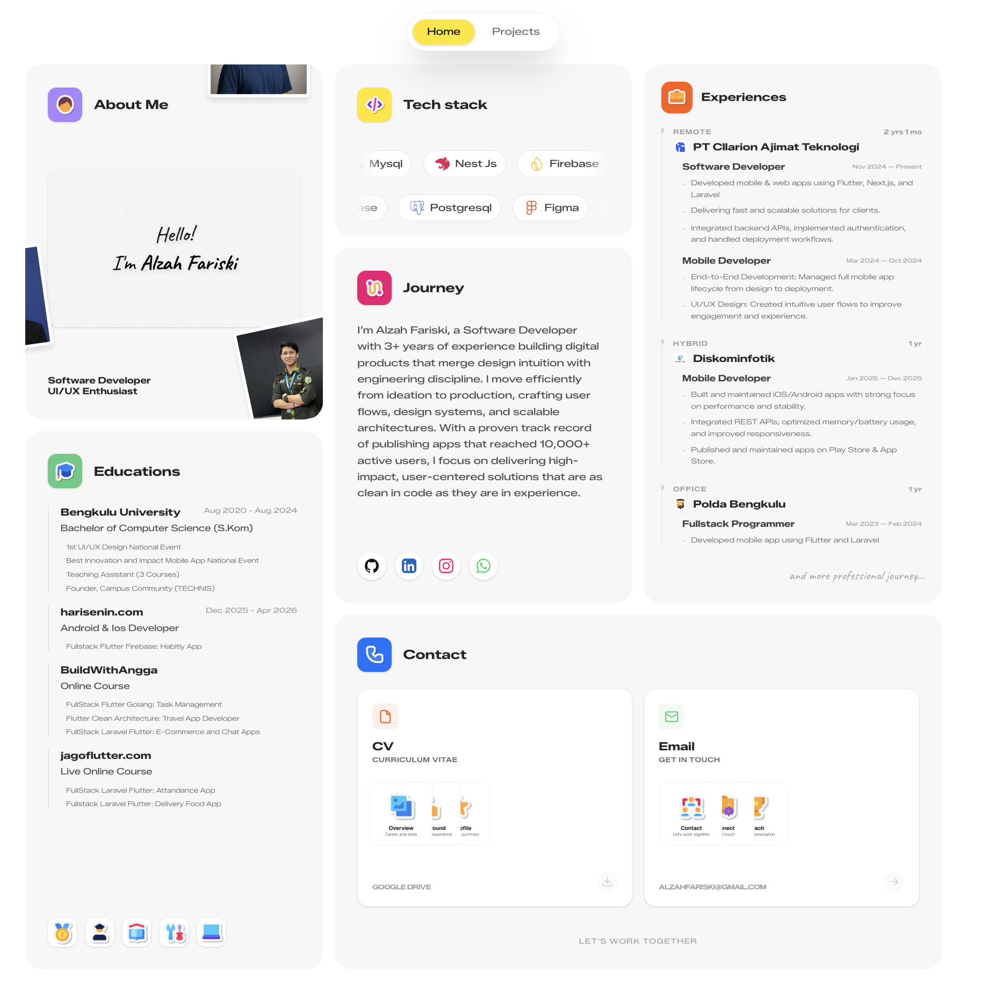

# Alzah Fariski - Modern Portfolio

A premium, interactive portfolio built with Next.js 16.4, featuring a dynamic Bento Grid layout and smooth micro-animations. This project showcases my journey, skills, and professional experience as an End-to-End Software Developer (design, build, deployment, and maintenance).



## 🚀 Features

- **Dynamic Bento Grid**: An organized, visually appealing layout for showcasing different facets of my profile.
- **Interactive Components**: Engaging experience, education, and skill cards with fluid animations powered by Framer Motion.
- **Firebase Integration**: Robust backend integration for profile data and real-time updates.
- **Modern Tech Stack**: Built with the latest versions of Next.js, React, and Tailwind CSS.
- **Aksesibilitas gerak**: animasi mengikuti `prefers-reduced-motion` (lewat `MotionConfig` di `components/motion-provider.tsx`).
- **Premium Aesthetics**: Curated color palettes, glassmorphism effects, and custom typography for a high-end feel.

## 🛠️ Tech Stack

- **Frontend**: [Next.js 16.4](https://nextjs.org/), [React 19](https://react.dev/), [TypeScript](https://www.typescriptlang.org/)
- **Styling**: [Tailwind CSS 4](https://tailwindcss.com/)
- **Animations**: [Framer Motion](https://www.framer.com/motion/)
- **Backend/Database**: [Firebase](https://firebase.google.com/)
- **Fonts**: [Zalando Sans Expanded](https://fonts.google.com/specimen/Zalando+Sans+Expanded) (teks utama), [Caveat](https://fonts.google.com/specimen/Caveat)

## 🏁 Getting Started

### Prerequisites

- Node.js 20.9+ (syarat Next.js 16)
- npm / pnpm / yarn

### Installation

1. Clone the repository:
   ```bash
   git clone https://github.com/alzahfariski/portofolio-alzah.git
   cd portofolio-alzah
   ```

2. Install dependencies:
   ```bash
   npm install
   ```

3. Set up environment variables:
   Create a `.env` file in the root directory and add your Firebase configuration:
   ```env
   NEXT_PUBLIC_FIREBASE_API_KEY=your_api_key
   NEXT_PUBLIC_FIREBASE_AUTH_DOMAIN=your_auth_domain
   # ... add other firebase variables
   ```

4. Run the development server:
   ```bash
   npm run dev
   ```

Open [http://localhost:3000](http://localhost:3000) with your browser to see the result.

## 📂 Project Structure

- `app/`: Next.js App Router pages and layouts.
- `components/`: Reusable UI components (Bento cards, Navbar, etc.).
- `firebase/`: Firebase configuration and initialization.
- `lib/`: Utility functions, types, and Firestore services.
- `public/`: Static assets including images and icons.

## 📬 Contact

Feel free to reach out via the contact card in the portfolio or connect with me on [LinkedIn](https://linkedin.com/in/alzah-fariski).

---

Developed with ❤️ by [Alzah Fariski](https://github.com/alzahfariski)

## Fixture data asli (SAMPLE_DATA=1)

- `fixtures/sample-data.ts` (pengalaman, pendidikan) dan `data/projects-live.json` (25 proyek) disalin dari data PUBLIK situs live https://alzahfariski.vercel.app/ pada 21 Nov 2026 (hanya baca, tanpa koneksi atau penulisan Firebase). Tanggal apa adanya dari Firestore (tidak diperbaiki).
- Cara memperbarui: ambil HTML beranda dan /project, ambil payload RSC (`self.__next_f.push`), salin ulang `experiences`, `educations`, dan daftar proyek (id, title, category, client, description, tags, year, URL gambar tanpa query) ke berkas di atas. Kunci/env Firebase tidak diperlukan.
- Tes: `SAMPLE_DATA=1 npm run build && SAMPLE_DATA=1 npm start`.
- Gambar asli proyek (`lh3.googleusercontent.com`) lewat `next/image`; hanya Habitly dan LaundryKu dipakai (`IMG_OK` di `data/featured.ts`). Cadangan: mockup SVG.
